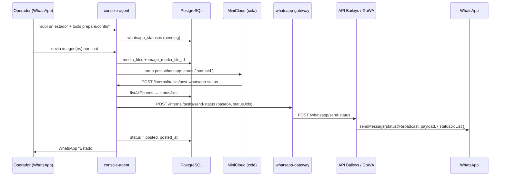

# Estados de WhatsApp — especificación Baileys (Exegeta) para implementar en GoWA

Documento de referencia para replicar la publicación de **Estados** (historias de 24 h, JID `status@broadcast`) tal como la expone hoy la API **Baileys** de Exegeta. El resto del producto (operador, BD, colas) **no cambia** si GoWA ofrece un contrato HTTP equivalente a `POST /whatsapp/send-status`.

**Audiencia:** quien implemente el endpoint en GoWA (whatsmeow) o quien adapte `GoWaMessagingProvider` en `whatsapp-gateway`.

**Código fuente de verdad (Exegeta):**

| Capa | Ruta |
|------|------|
| Protocolo Baileys | `Baileys/src/services/whatsapp.service.js` → `sendStatus` |
| API REST | `Baileys/src/routes/whatsapp.routes.js`, `validators/whatsapp.validator.js`, `controllers/whatsapp.controller.js` |
| Contrato dominio | `Core/packages/messaging/src/messaging-provider.ts` → `SendStatusMessageInput` |
| Gateway | `Core/apps/whatsapp-gateway/src/baileys-messaging-provider.ts`, `server.ts` → `/internal/tasks/send-status` |
| Orquestación | `Core/apps/console-agent/src/handlers/post-whatsapp-status.ts`, `tool-packs/whatsapp-status.ts` |
| Adjuntar media (operador) | `Core/apps/console-agent/src/handlers/inbound.ts` → `attachMediaToPendingWhatsAppStatus` |
| Persistencia | `Core/packages/database/migrations/20260721010000_whatsapp_statuses.cjs` |

---

## 1. Qué es un “Estado” en este proyecto

- En WhatsApp, un **Estado** es contenido efímero (~24 h) en la pestaña **Actualizaciones / Estados**, no un mensaje de chat.
- En el protocolo, el destino de envío **no** es `569...@s.whatsapp.net`, sino el JID fijo **`status@broadcast`**.
- Exegeta usa Estados para que el **operador** (número `supportWhatsappNumber`) publique texto, imagen o video en la **historia del número conectado** a la sesión WhatsApp (Baileys hoy; GoWA mañana).
- **No** se confunde con:
  - **Mensaje 1:1** → `send-text` / `POST /send/message`
  - **Difusión** → fan-out de N mensajes a N teléfonos (`broadcast` en console-agent)

---

## 2. Concepto crítico: `statusJids` / `statusJidList`

Publicar en `status@broadcast` **no** equivale a “mandar la foto a cada contacto por DM”.

WhatsApp necesita una lista explícita de **JIDs de contactos** a quienes **distribuir la clave / notificación** del estado. En Baileys esto es el tercer argumento de `sendMessage`:

```javascript
// Baileys — simplificado desde whatsapp.service.js
const STATUS_JID = 'status@broadcast';

const options = { statusJidList: statusJids };
if (kind === 'text') {
  if (backgroundColor) options.backgroundColor = backgroundColor;
  if (typeof font === 'number') options.font = font;
}

await sock.sendMessage(STATUS_JID, payload, options);
```

**Comportamiento observado en producción (documentado en código):**

- Si `statusJids` está vacío o se omite → error HTTP 400 en la API Baileys.
- Si se publica **sin** lista válida → técnicamente puede “subirse”, pero **nadie ve el estado** (Baileys no infiere la audiencia desde la agenda del teléfono).

**En Exegeta**, al confirmar un estado, `post-whatsapp-status.ts` arma:

```typescript
const users = await container.users.listAllPhones();
const statusJids = users.map((u) => `${u.phone}@s.whatsapp.net`);
```

Es decir: **todos los usuarios registrados en la base** (teléfono normalizado sin `@`), no “todos los contactos del teléfono”. Eso es una decisión de producto; GoWA debe aceptar la lista tal cual llega en el body.

**Formato de cada JID:** `{digits}@s.whatsapp.net` (Chile: `569...@s.whatsapp.net`). Grupos **no** van en `statusJids`.

---

## 3. Tipos de contenido soportados

| `kind` | Payload Baileys (`sendMessage` 2º arg) | Opciones (3º arg) | Validación API Baileys |
|--------|----------------------------------------|-------------------|-------------------------|
| `text` | `{ text: string }` | `statusJidList`, opcional `backgroundColor` (`#RRGGBB`), opcional `font` (0–8) | `text`: 1–700 chars |
| `image` | `{ image: Buffer, mimetype }`, opcional `caption` | `statusJidList` | `fileBase64` + `mimetype` obligatorios |
| `video` | `{ video: Buffer, mimetype }`, opcional `caption` | `statusJidList` | idem |

**Detalle de implementación Baileys (importante para GoWA):**

- `backgroundColor` y `font` **no** van dentro del objeto de contenido del mensaje; van en **opciones** junto a `statusJidList`. Si se meten solo en el payload de texto, Baileys/WhatsApp **los ignora** y el fondo cae al default (celeste).
- Media: buffer desde `fileBase64` (JSON) o `fileBuffer` (multipart `attachment` en la misma ruta).

**Campo `font` en Exegeta:** la API Baileys lo acepta, pero el flujo operador (`prepareWhatsAppStatus`) **no lo persiste** hoy; suele ir `undefined`. GoWA puede implementarlo igual por compatibilidad futura.

---

## 4. Contrato HTTP actual — `POST /whatsapp/send-status`

**Base:** API Baileys (puerto 3001 prod / 3101 dev).  
**Auth:** header `x-api-key`.  
**Ruta:** montada bajo prefijo `/whatsapp` → **`POST /whatsapp/send-status`**.

### 4.1 Body JSON (`Content-Type: application/json`)

Campos validados por Joi (`Baileys/src/validators/whatsapp.validator.js`):

```json
{
  "kind": "text",
  "text": "Texto del estado",
  "backgroundColor": "#075E54",
  "font": 0,
  "statusJids": ["56952021860@s.whatsapp.net", "56965049986@s.whatsapp.net"]
}
```

```json
{
  "kind": "image",
  "fileBase64": "<base64>",
  "mimetype": "image/jpeg",
  "caption": "Opcional",
  "statusJids": ["56952021860@s.whatsapp.net"]
}
```

```json
{
  "kind": "video",
  "fileBase64": "<base64>",
  "mimetype": "video/mp4",
  "caption": "Opcional",
  "statusJids": ["56952021860@s.whatsapp.net"]
}
```

**Reglas:**

- `kind`: `text` | `image` | `video` (requerido).
- `statusJids`: array no vacío de strings (requerido).
- `text`: requerido solo si `kind === 'text'`; prohibido en image/video.
- `backgroundColor`: opcional, regex `^#[0-9A-Fa-f]{6}$`, solo text.
- `font`: opcional entero 0–8, solo text.
- `fileBase64` + `mimetype`: requeridos para image/video (mismos límites que otros endpoints de media en Baileys).
- `caption`: opcional en image/video.

### 4.2 Body multipart (alternativa)

Misma ruta con `multipart/form-data`, campo archivo `attachment`, más campos de formulario según `sendStatusFile` (`kind`, `caption`, `statusJids`). El controller fusiona `req.file.buffer` con el body JSON.

Exegeta **solo usa JSON + base64** desde `BaileysMessagingProvider.sendStatus`.

### 4.3 Respuesta exitosa

Patrón genérico Baileys: `{ success: true, message: 'Estado publicado correctamente', ... }`.  
Exegeta **no** depende del `message_id` devuelto para estados (no se correlaciona en BD).

### 4.4 Errores

- 400: validación (`statusJids` vacío, falta `text`/`fileBase64`, etc.).
- 503/500: sesión WhatsApp no lista (`assertReady`).

---

## 5. Flujo end-to-end en Exegeta (sin cambiar al migrar el puente)



### 5.1 Estados en BD (`whatsapp_statuses`)

| Columna | Uso |
|---------|-----|
| `kind` | text \| image \| video |
| `text`, `background_color`, `font`, `caption` | Contenido |
| `image_media_file_id` | FK a `media_files` (imagen **o** video) |
| `status` | pending → sending → posted \| cancelled \| failed |
| `created_by_conversation_id` | Conversación del operador |

Ventana operativa: consultas de “pendientes listos” filtran **`created_at > now() - 30 minutes`** para no republicar estados viejos ni enganchar media ajena.

### 5.2 Colas e idempotencia

1. **`post-whatsapp-status`** (console-agent): lee BD, descarga media de object storage, llama al gateway.
2. **`/internal/tasks/send-status`** (gateway): valida `statusId`, `kind`, `statusJids`; idempotencia en memoria `markAsSent('status', statusId)` para no publicar dos veces el mismo id si hay reintentos.
3. Si falla el envío → HTTP 500 → MiniCloud reintenta; si agota → dead-letter marca `whatsapp_statuses.status = 'failed'` y avisa al operador.

**Un estado confirmado = una sola llamada HTTP al puente WhatsApp** (no fan-out por usuario).

---

## 6. Entrantes: qué hace Baileys (y qué no necesita GoWA replicar para publicar)

En `normalizeIncomingMessage`, Baileys **descarta** mensajes cuyo `remoteJid === 'status@broadcast'`. Exegeta **no** procesa historias ajenas como inbound del bot.

La recepción de **archivos del operador** para armar un estado usa el flujo normal de chat 1:1 (`inbound.ts` → `attachMediaToPendingWhatsAppStatus`), no el JID `status@broadcast`.

---

## 7. Especificación para implementar en GoWA

GoWA (OpenAPI v9 en `:9000`) expone `/send/message`, `/send/image`, `/send/video`, etc., orientados a **un `phone` destino**. Eso **no** sustituye un Estado.

### 7.1 Endpoint recomendado (paridad Exegeta)

Implementar algo equivalente a:

**`POST /send/status`** (o mantener el path legacy **`POST /whatsapp/send-status`** si queréis drop-in con mínimos cambios en Exegeta).

**Headers:**

- Autenticación GoWA (Basic Auth según despliegue).
- `X-Device-Id`: dispositivo que publica (en Exegeta sería el device del número operador, p. ej. `Exegeta`).

**Body JSON (misma forma que Baileys):**

| Campo | Tipo | Notas |
|-------|------|--------|
| `kind` | string | text \| image \| video |
| `text` | string | si kind=text |
| `backgroundColor` | string | `#RRGGBB`, opcional |
| `font` | int | 0–8, opcional |
| `fileBase64` | string | image/video |
| `mimetype` | string | image/video |
| `caption` | string | opcional image/video |
| `statusJids` | string[] | **obligatorio**, no vacío |

**Multipart:** opcional (Exegeta no lo usa hoy).

### 7.2 Implementación en whatsmeow (orientación)

Baileys y GoWA usan stacks distintos pero el requisito de protocolo es el mismo:

1. Destino **`status@broadcast`** (no JID del contacto).
2. Contenido según tipo (text / image / video).
3. Opciones de envío con **`StatusJidList`** (nombre en whatsmeow; en Baileys `statusJidList`) = array de JIDs pasados en `statusJids`.
4. Para texto: **`BackgroundColor`** y **`Font`** en opciones de estado, no mezclados en el body de forma que el cliente ignore.

Consultar en el código de GoWA/whatsmeow ejemplos de “status message” o `SendMessage` hacia `status@broadcast` con lista de JIDs (no confundir con `SendImage` a un chat).

### 7.3 Qué NO debe hacer GoWA

| Incorrecto | Correcto |
|------------|----------|
| `POST /send/image` con `phone: 569...@s.whatsapp.net` por cada usuario | Una sola publicación a `status@broadcast` + `statusJids` |
| Omitir `statusJids` y asumir “todos mis contactos del teléfono” | Aceptar lista explícita (Exegeta manda usuarios de BD) |
| Tratar caption/color como mensaje normal de chat | Respetar opciones de estado para texto (fondo/fuente) |

### 7.4 Integración mínima en Exegeta tras tener el endpoint

1. `GoWaMessagingProvider.sendStatus` → mismo JSON que hoy `BaileysMessagingProvider` (cambiar URL, auth, `X-Device-Id`).
2. No tocar `post-whatsapp-status.ts` ni tools si el contrato HTTP es compatible.
3. Probar: estado texto con color, imagen con caption, lote de 3 imágenes (3 POST separados), idempotencia con reintento de cola.

### 7.5 Criterios de aceptación (checklist)

- [ ] `kind=text` visible en Actualizaciones para un usuario cuyo JID esté en `statusJids` y tenga al operador agendado (privacidad WhatsApp aplicable).
- [ ] `backgroundColor` distinto del default cuando se envía `#RRGGBB`.
- [ ] `kind=image` y `kind=video` con mimetypes habituales (jpeg, mp4).
- [ ] Error 400 si `statusJids` vacío o falta media/texto según kind.
- [ ] Error claro si dispositivo no está `logged_in`.
- [ ] Varios estados seguidos (misma sesión) no corrompen sesión ni duplican por error del servidor (Exegeta ya deduplica por `statusId` en gateway).

---

## 8. Diferencias conocidas Baileys ↔ GoWA (planificación)

| Tema | Baileys (Exegeta) | GoWA (estado actual doc OpenAPI) |
|------|-------------------|----------------------------------|
| Publicar Estado | `POST /whatsapp/send-status` | **Sin endpoint equivalente documentado** |
| Auth | `x-api-key` | Basic Auth + `X-Device-Id` |
| Media | JSON base64 | Resto de API usa multipart |
| Multidispositivo | Una sesión por proceso | Varios devices; elegir cuál publica |

---

## 9. Referencia rápida — llamada desde gateway hoy

`BaileysMessagingProvider.sendStatus` (`Core/apps/whatsapp-gateway/src/baileys-messaging-provider.ts`):

```typescript
await fetch(`${baseUrl}/whatsapp/send-status`, {
  method: 'POST',
  headers: { 'content-type': 'application/json', 'x-api-key': apiKey },
  body: JSON.stringify({
    kind: input.kind,
    text: input.text,
    backgroundColor: input.backgroundColor,
    font: input.font,
    fileBase64: input.fileBase64,
    mimetype: input.mimetype,
    caption: input.caption ?? undefined,
    statusJids: input.statusJids,
  }),
});
```

Payload típico que llega desde `post-whatsapp-status` (después de leer storage):

```json
{
  "statusId": 42,
  "kind": "image",
  "fileBase64": "...",
  "mimetype": "image/jpeg",
  "caption": null,
  "statusJids": ["56952021860@s.whatsapp.net", "..."]
}
```

El gateway **no** reenvía `statusId` a Baileys; solo lo usa para idempotencia local.

---

## 10. Glosario

| Término | Significado |
|---------|-------------|
| Estado / Status | Historia efímera WhatsApp (24 h) |
| `status@broadcast` | JID de publicación en el protocolo |
| `statusJids` / `statusJidList` | Audiencia técnica: contactos que reciben el estado |
| Operador | Usuario cuyo teléfono = `supportWhatsappNumber` |
| `whatsapp_statuses` | Borrador/publicación en BD Exegeta, no confundir con “status HTTP” |

---

*Generado a partir del código en repo Exegeta-AI-dev. Actualizar este doc si cambian validadores Baileys o el contrato `SendStatusMessageInput`.*
